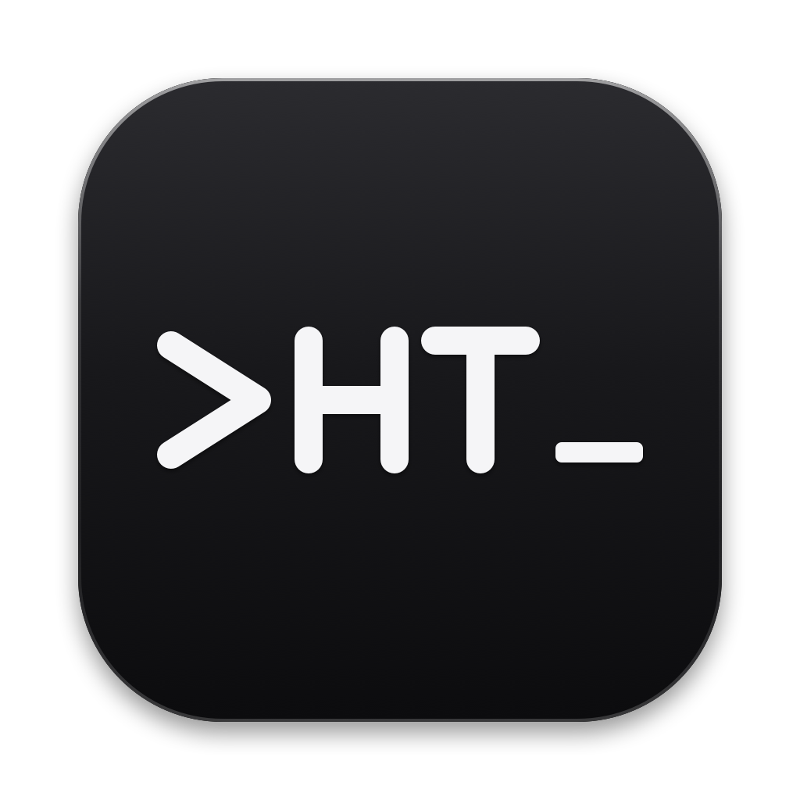

# Herb's Terminal

**Herb's Terminal** is a native macOS terminal for administrators. It runs on Apple silicon Macs (macOS 15+) and manages local files and remote Linux, macOS, and Windows machines over SSH.

Each tab pairs a shell with an SSH-aware file explorer. When the shell connects to another machine, the explorer follows it to the same host and account — shell, files, transfers, text editing, and permissions all in one tab.



## Features

- **SSH-aware file explorer** — in the style of Thunar, with a built-in text editor; follows the shell when you SSH to another host
- **MultiExec** — type into several terminals at once, like MobaXterm
- **Encrypted login vault** — save SSH credentials with AES-256 encryption
- **Administrator mode** — work on files as root over SFTP, with safe upload semantics
- **Tailcat pairing** — reach machines that can't see each other by IP, via the bundled `tailcat` helper
- **Split panes** — horizontal and vertical splits per tab
- **Session restore** — reopen tabs where you left them after a restart
- **iTerm2 color preset import** — `.itermcolors` themes drop straight in
- **SFTP transfer queue** — upload and download with progress, retry and cancel

## Requirements

- macOS 15 or later
- Apple silicon (arm64)

Nothing else needs to be installed. The app bundles its own SSH helpers and `tailcat`; it uses the system's `/usr/bin/ssh`, `/bin/sh`, `/usr/libexec/sftp-server`, and `sudo` — never Homebrew or PATH copies.

## Download

Grab the latest `.zip` from [Releases](https://github.com/dunkelherzmann/herbs-terminal/releases), unzip it, and drag **Herb's Terminal.app** to your Applications folder.

> **Gatekeeper note:** the app is not notarized. Right-click → Open the first time to bypass the unsigned-app warning.

## Building from source

```bash
# build and sign dist/Herb's Terminal.app
script/build_and_run.sh

# assemble the .app without launching it
script/build_and_run.sh --bundle

# build and run the test suite (includes real SFTP transfers)
script/test.sh
```

Built with **Swift 6**, **SwiftUI + AppKit**, [SwiftTerm 1.20](https://github.com/migueldeicaza/SwiftTerm), and Swift Package Manager.

## Project layout

```
Sources/
  HerbsTerminal/       main app target (SwiftUI + AppKit)
  HerbsTerminalUI/     shared UI components (toolbar, panes)
Tests/
  HerbsTerminalTests/  unit and integration tests
Assets/                app icon source files
Vendor/tailcat/        bundled tailcat binary + license
script/                build, icon generation, and test scripts
docs/                  feature audits and design plans
dist/                  build output (gitignored)
```

## Dependencies

| Dependency | Version | License |
|---|---|---|
| [SwiftTerm](https://github.com/migueldeicaza/SwiftTerm) | 1.20.0 | MIT |
| [tailcat](https://github.com/tailscale/tailcat) | 0.7.0 (bundled) | BSD-3-Clause |

## Security notes

- Passwords and Tailcat addresses never appear in command lines, shell history, or logs
- The login database uses AES-256 encryption; if it can't be opened the app falls back to a safe in-memory store
- Administrator mode uploads use unguessable temporary filenames and never write through existing files or preserve setuid/setgid bits
- The SSH socket folder is verified to be a real directory owned by the current user with mode `0700`

## License

Copyright © 2026 Herbert Cisneros. All rights reserved.
